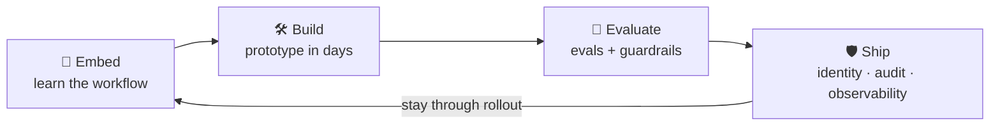
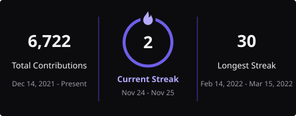

<!--
  chanchalvdev/chanchalvdev — profile README
  - Preview on github.com/chanchalvdev, not in an editor (GitHub proxies images through camo).
  - No <picture> tags: GitHub strips them.
  - streak.svg is generated daily by .github/workflows/streak.yml (scripts/streak.py).
  - Stuck broken image? GitHub cached the failure: curl -X PURGE "<camo.githubusercontent.com URL>"
-->

<div align="center">


<a href="https://chanchalverma.dev">
  
</a>

<p>
  
  
  
  <br/>
  
  
  
</p>

<p>
  <a href="https://chanchalverma.dev"></a>
  <a href="https://linkedin.com/in/chanchalvdev"></a>
  <a href="https://chanchalverma.dev/blog/"></a>
  <a href="https://x.com/chanchalvdev"></a>
  <a href="mailto:chanchalverma.dev@gmail.com"></a>
</p>

</div>

<br/>

```yaml
engineer:
  name: Chanchal Verma
  role: [Forward Deployed Engineer, AI Engineer, Product Engineer, Technical Lead]
  based_in: Abu Dhabi, UAE
  now: Building a multi-agent AI platform for threat-intel & incident-response teams @ CPX
  superpower: "Turn a vague ask into a working AI prototype in days, then harden it for production"
  default_mode: embed -> build -> ship -> stay through rollout
  non_negotiable: security by design, not bolted on
```

<div align="center">

| **6+ years** | **4 countries** | **200+** | **Air-gapped** |
|:---:|:---:|:---:|:---:|
| shipping production software | UAE · Germany · India · US | developers mentored | self-hosted LLMs on H100s |

</div>

<br/>

### ⚡ What I bring to a team

<table>
<tr>
<td width="33%" valign="top">

**🛰️ Forward Deployed**<br/>
<sub>I sit with the people doing the work, find where their day breaks down, and own the problem end to end, from discovery to rollout.</sub>

</td>
<td width="33%" valign="top">

**🤖 AI Engineering**<br/>
<sub>Multi-agent systems, MCP tools, RAG pipelines, evals and LLMOps, running on hosted APIs or self-hosted models.</sub>

</td>
<td width="33%" valign="top">

**🧩 Product Engineering**<br/>
<sub>Full-stack ownership: the agent, the backend, the UI and the workflow around it. Prototype in days, not quarters.</sub>

</td>
</tr>
<tr>
<td width="33%" valign="top">

**🔌 Systems Integration**<br/>
<sub>Wiring LLMs into real stacks: SIEMs, Kafka, Temporal, identity providers, object stores and on-prem GPUs.</sub>

</td>
<td width="33%" valign="top">

**🧭 Technical Leadership**<br/>
<sub>Led Go & Kubernetes delivery for an enterprise client and mentored 200+ developers. I lead by shipping.</sub>

</td>
<td width="33%" valign="top">

**🛡️ AI Security**<br/>
<sub>Scoped credentials, guardrails, human-in-the-loop approval and audit trails, designed in from day one. OWASP LLM Top 10 aware.</sub>

</td>
</tr>
</table>

<br/>

### 🔁 How I work



<br/>

### 🔭 Right now: AI Engineering @ [CPX](https://www.cpx.net)

Building a **multi-tenant, multi-agent AI platform** used every day by threat-intelligence and incident-response teams.

- **Agents that do analyst work:** threat-actor profiling, MITRE ATT&CK mapping, malware and vulnerability intel, incident analysis (Python · LangGraph · Agno · MCP)
- **Safe by construction:** each agent runs with its own scoped tools and credentials, plus guardrails, output validation, human-in-the-loop approval and a full audit log
- **Built to survive production:** a Go backend-for-frontend on Kafka + Temporal, so long-running AI workflows are fault-tolerant and resumable
- **Runs where the data lives:** self-hosted models on on-prem NVIDIA H100s and air-gapped environments for UAE data residency, traced end-to-end with Langfuse + OpenTelemetry

<br/>

### 🚀 Featured work

| Project | What it does | Proof |
|---|---|---|
| 🔎 **[Casewright](https://github.com/chanchalvdev/casewright)**<br/><sub>Go · React · Sigma · Ollama · Qdrant</sub> | An open-source, local-first **AI security analyst**. It takes alerts from Wazuh, Elastic or Security Onion, groups them into one case per attack, investigates with an LLM and proposes a response that a human approves. | P1–P5 triage · MITRE mapping · one-command Docker demo<br/>[Case study →](https://chanchalverma.dev/projects/go-siem-agent-llm-classifier/) |
| 🧠 **[ThreatRAG](https://github.com/chanchalvdev/threat-RAG)**<br/><sub>Python · FastAPI · LangGraph · Qdrant</sub> | **Agentic threat-intel RAG.** It gives cited answers from MITRE ATT&CK, OWASP and NVD, then runs a Researcher → Critic → Reporter investigation on any IOC. | <2s to first token · 39/39 tests · hardened against the OWASP LLM Top 10<br/>[Case study →](https://chanchalverma.dev/projects/threat-rag/) |
| 📦 **[Ingestion Platform](https://github.com/chanchalvdev/parser-app)**<br/><sub>Go · Python · MinIO · OpenSearch</sub> | Turns a **10 GB encrypted evidence archive** into searchable, indicator-tagged records. Extraction is hardened against zip bombs and path traversal. | 10 GB single-file ingest · 10 IOC classes · partial success by design<br/>[Case study →](https://chanchalverma.dev/projects/file-ingestion-parser/) |

<br/>

### 🧰 Toolbox

<div align="center">


<br/>


</div>

| | |
|---|---|
| **🤖 AI & Agents** |       |
| **📈 LLMOps** |    |
| **🔌 Integration** |      |
| **🛡️ Security** |     |

<br/>

### 🗺️ Journey

| When | Role | Where |
|---|---|---|
| **2025 →** | Senior Full Stack Engineer, AI Engineering | **CPX**, Abu Dhabi 🇦🇪 |
| 2025 | Technical Lead, Go & Kubernetes (client: HP Inc.) | **HCL Technologies**, Bengaluru 🇮🇳 |
| 2024 – 25 | Founding Software Engineer, cloud security platform | **StackGuardian**, Germany (remote) 🇩🇪 |
| 2023 – 24 | Full Stack & DevOps Engineer | **Thor Solutions**, remote |
| 2021 – 23 | Associate Software Engineer, mentored 200+ devs | **Masai School**, remote |
| 2020 – 21 | Full Stack Developer | **Smashing Infolabs**, Indore |

<br/>

<div align="center">

<a href="https://github.com/chanchalvdev">
  
</a>

<br/><br/>

**Got a messy problem where AI could help, and where security can't be an afterthought?**<br/>
I'd like to hear about it → **[chanchalverma.dev@gmail.com](mailto:chanchalverma.dev@gmail.com)**


</div>
